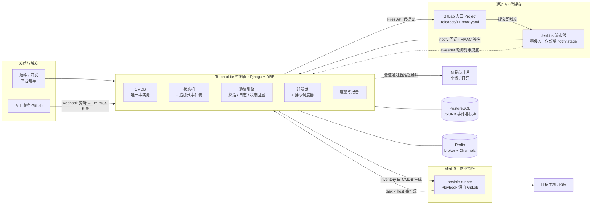
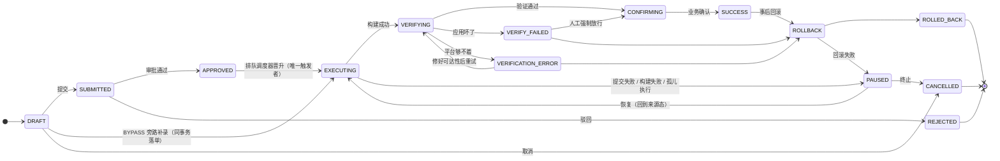

# TomatoLite

> 小而美的发布闭环平台 —— 以 CMDB 为地基，包住既有 GitLab → Jenkins 链路与 Ansible 作业，让每一次发布从发起到确认全程数字化。

需求源：[`PRD.md`](PRD.md) · 工程设计：[`docs/design-notes.md`](docs/design-notes.md) · 实施进度：[`docs/implementation-plan.md`](docs/implementation-plan.md)

---

## 设计三铁律（不可违反的边界纪律）

| # | 铁律 | 含义 |
|---|---|---|
| 1 | **不重造轮子** | 构建归 Jenkins、执行归 Ansible、资产归 GitLab；TomatoLite 只做 CMDB、单据状态机、闭环数字化 |
| 2 | **CMDB 唯一事实源** | 主机/应用/环境只存 CMDB，任何模块禁止私建主机表 |
| 3 | **无闭环不算完成** | 发布单未走完"验证 + 反馈"不允许到达终态 |

**非目标**：不做 CI 构建能力、不做自研 Agent（一期 SSH）、不做代码托管/MR 评审、不做多租户与可视化拖拽编排。

---

## 系统总体架构



**双通道**：通道 A = 平台代提交清单 → GitLab webhook → Jenkins 流水线 → 回调；通道 B = 平台内置 `ansible-runner` 直接执行，事件流逐行回传。两条通道共用同一套单据状态机与验证/闭环后半程。

**已冻结的关键决策**（ADR 全文见 [`PRD.md`](PRD.md) §12）：

| 决策项 | 结论 |
|---|---|
| 入口触发约定 | 提交即触发（commit 级），Jenkins 零改动 |
| Jenkins 状态回传 | 回调为主（notify stage）+ 轮询对账兜底（sweeper）——推送保实时、拉取保正确 |
| 数据库 | PostgreSQL（JSONB 存事件载荷 / 时间线 / 验证快照） |
| Ansible 调用 | `ansible-runner` 程序化调用，事件流回传 |
| 实时日志 | WebSocket |
| 部署形态 | 一期单机 Docker Compose |

---

## 发布单状态机（双轨共用主干）



四个语义要点（**权威迁移表是 [`docs/design-notes.md`](docs/design-notes.md) §1.3.1 的 31 条边**，本图只是主干速览）：

- **`VERIFY_FAILED` ≠ `VERIFICATION_ERROR`**：前者是"应用坏了"（提示回滚），后者是"平台够不着"（提示先修可达性再重试）。合并二者会驱动运维回滚一个其实成功的发布——"验证引擎反而制造故障"。
- **`APPROVED` 不持有并发锁**：它只是"已批准待调度"。锁由 `EXECUTING / VERIFYING / CONFIRMING / ROLLBACK` 等执行态持有，`APPROVED → EXECUTING` 由排队调度器唯一触发。**审批通过不等于立即开始发布**，被占用时单据停在"已批准"并显示排队位次，前者结束即自动晋升。
- **`SUCCESS` 是闭环但不再是终态**：闭环后可发起事后回滚（必须显式指定目标版本），度量按**最终态**统计——"先成功、后回滚"的单计入回滚率而非成功率。终态只有 `REJECTED` / `ROLLED_BACK` / `CANCELLED`。
- **人工强制放行是受限出口**：仅对 `VERIFY_FAILED` 开放（对 `VERIFICATION_ERROR` **必须拒绝**），执行者须 ≥ 审批人级别且非发起人、理由必填，UI 上必须与"干净的成功"一眼可辨，并计入强制放行率看板。

---

## 技术栈

| 层 | 选型 | 说明 |
|---|---|---|
| 后端 | Django 6.1.1 + DRF 3.18.1 | ASGI 由 daphne 4.2.3 承载；API 契约 drf-spectacular 0.30.0 |
| 异步任务 | Celery 5.6.3 + Redis 8.1.0 | 不用 `celery[redis]` extras（其 pin 的 redis-py 上限 < 8），见 `requirements.txt` 注释 |
| 实时日志 | Channels 4.3.2 + channels-redis 4.3.0 | 通道 B 的 task × host 事件流走 WebSocket |
| 数据库 | PostgreSQL ≥ 15（本机实例，非容器） | JSONB 存事件载荷/时间线/验证快照；启动即强制校验版本（S0-8 全局闸） |
| 外部集成 | httpx 0.28.1 · asyncssh 2.24.0 | `integrations/` 只准 httpx + 标准库；SSH 目标主机走 asyncssh |
| 前端 | Vue 3 + Element Plus | OQ-6 已确认；一期尚未落地（见进度台账） |
| 测试与质量门 | pytest 9.1.1 + pytest-django · ruff · black | 覆盖率地板 50（棘轮只升）；pre-commit 钩子直调 `.venv/bin/` |
| 部署形态 | Docker Compose（单机） | `app` + 四类 worker + `beat` + `redis`，队列拓扑见 design-notes §0.5 |

---

## 快速开始

**前置**：Python 3.12.13（pyenv + `.venv/`）· PostgreSQL ≥ 15（**本机实例、不进容器**，口径见 design-notes §0.6a）· Docker（起 Redis 与平台服务）。

```bash
# 1) 环境变量：base.py 对所有项零默认值——缺任何一行，check 必须失败（防真密钥进 git 的负断言）
cp .env.example .env
.venv/bin/python manage.py check

# 2) 建表（本机 PG；测试库由 runner 自建，依赖 postgres 角色的 CREATEDB）
.venv/bin/python manage.py migrate

# 3) 起服务：redis + app(daphne) + 四类 worker + beat（队列拓扑见 design-notes §0.5）
docker compose up -d
curl -sS http://127.0.0.1:8000/healthz/     # 200

# 4) 测试与质量门
.venv/bin/pytest                            # 覆盖率地板 50（棘轮只升）
pre-commit run --all-files                  # ruff(lint) + black(format)
```

> M1 起若要在容器内跑 `migrate`，需先按 §0.6a 处理本机 PG 的 `listen_addresses`——当前 compose 的服务项直连 `host.docker.internal:5432`。

### 临时联调栈（真 GitLab / Jenkins）

```bash
docker compose -f docker-compose.integration.yml -p tl-s09 up -d   # GitLab :8929 · Jenkins :8920（仅绑环回）
.venv/bin/python scripts/s0_9_bootstrap.py gitlab                  # 建仓/钩子/代提交 → 出站可达性双相证据
.venv/bin/python scripts/s0_9_bootstrap.py jenkins                 # 建 job/触发/签名回调 → 同上
```

它是**可随时 `down -v` 的一次性工件**，用于人工联调与里程碑演示：**任何 CI 用例、任何自动断言不得依赖它**（自动化基座永远是 `mocks/` 承托的 Mock 层）。切真/切假只动 `INTEGRATION_MODE` 与 base_url，业务代码零分支。

---

## 仓库布局

```
TomatoLite/
├── manage.py
├── PRD.md                     # 产品需求（含 ADR 冻结决策）
├── docker-compose.yml         # 本地开发栈：redis + app(daphne) + 四类 worker + beat
├── docker-compose.integration.yml  # 临时联调栈：真 GitLab + Jenkins（工程名 tl-s09）
├── config/
│   ├── settings/{base,local,test,prod}.py   # 分片 settings（§0.6）
│   └── urls.py  asgi.py  wsgi.py  celery.py  routing.py
├── apps/                      # 业务域
│   ├── core/                  # 抽象模型、RBAC、HMAC 签名、统一响应与异常、分页
│   ├── cmdb/                  # 唯一事实源：system/app/env/host + 验证配置 + inventory 生成
│   ├── tickets/               # 状态机 + 追加式事件表 + 并发锁 + 审批 + 排队
│   ├── channels_a/            # 通道 A：代提交 / Jenkins 回调 / 对账 sweeper
│   ├── channels_b/            # 通道 B：ansible-runner 执行 / 事件泵 / task 结果
│   ├── verification/          # 验证引擎：探活 / 日志扫描 / 状态回显
│   ├── feedback/              # IM 确认闭环
│   └── metrics/               # 度量与报告
├── integrations/              # 纯接口 + DTO，零 Django 依赖（gitlab / jenkins / im / k8s）
├── mocks/                     # 假外部系统：gitlab_fake / jenkins_fake / host_fake（独立进程）
├── scripts/                   # 拓扑自证、联调栈 bootstrap
├── tests/                     # unit /（integration、concurrency 随 M1 起落地）
└── docs/                      # design-notes · implementation-plan · spikes
```

**四条边界规则**（违反即视为设计缺陷，全文见 design-notes §0.2）：`integrations/` 不 import Django；业务代码零外部系统分支（差异只在 base_url）；CMDB 之外禁止私建主机表；协议细节不越过 `integrations/` 边界。

---

## 文档导航

| 文档 | 读它的时候 |
|---|---|
| [`PRD.md`](PRD.md) | 想弄清"产品要什么"：角色权限、功能需求、状态机业务语义、**12 条 ADR 冻结决策及其理由** |
| [`docs/design-notes.md`](docs/design-notes.md) | 动手写代码前：模型定义、**31 条权威迁移表（§1.3.1）**、四层并发锁、队列拓扑、四条边界规则。**它是工程事实源——改动前先改它** |
| [`docs/implementation-plan.md`](docs/implementation-plan.md) | 想知道"现在做到哪、下一步做什么"：101 个任务的进度、依赖、风险等级与验证强度。**进度的唯一事实源** |
| [`docs/spikes/`](docs/spikes) | 想追某条设计结论的实据：S0-1（ansible 事件流）/ S0-2（WebSocket 逐行输出）原始报告与证伪记录 |

---

## 进度快照（2026-10-14）

- **S0 工程基建**：11 项闭环（S0-1 spike → S0-9 联调栈）。其中 S0-9 交付**前半**：栈与出站可达性双相证据齐备；"落 BYPASS 单 / 验签入队"两条依赖 M1-24 / M2-05 端点，挂账至那两个任务验收时在本栈复验销账。
- **M1 / M2 / M3**：未开工（M1 = CMDB + 状态机 + 通道 B + Webhook 旁听）。
- **测试**：141 passed；覆盖率 53.37%（地板 50）。
- ⚠️ 本段是**带日期的快照**，唯一事实源是 [`docs/implementation-plan.md`](docs/implementation-plan.md)——两者不一致时以台账为准。

---

## License

[MIT](LICENSE)
